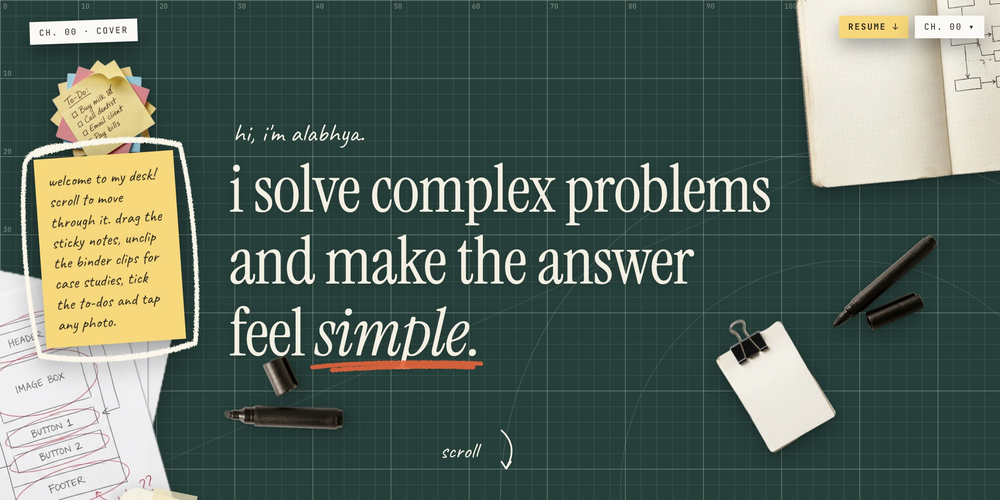

<p align="center">
  <a href="https://alv-portfolio.vercel.app">
    
  </a>
</p>

# Alabhya Vaibhav: portfolio

**Live:** [alv-portfolio.vercel.app](https://alv-portfolio.vercel.app)

My portfolio, laid out like a desk: a self-healing cutting mat with work and life scattered across it. I'm a product manager at Itron, working on worker safety and on moving the team from SDLC to AIDLC. The site covers that work, the jobs before it, the things I build on the side, photography, and Bailey (the cat).

As you scroll, each chapter's paper slides onto the mat, holds while you read, and gets swept off for the next one. On phones everything moves with the scroll instead, rising from below.

## Chapters

| # | Chapter | What's on the desk |
|---|---|---|
| 00 | Cover | The headline, written onto the mat in ink, and a welcome note on how to use the desk |
| 01 | Day job | Itron (worker safety, SDLC to AIDLC), then a CommerceIQ receipt, a Soroco process map and a Quikr Jobs classifieds clipping |
| 02 | Behind the camera | 54 photos in three piles: places, people & streets, Bailey |
| 03 | Side projects | A carousel of projects and writing; unclip a card's binder clip for its case study |
| 04 | Off the clock | Bailey, a to-do list you can tick, and fan stickers |
| 05 | Say hi | Contact, resume, and me & Bailey as a sticker |

## Things you can do

- **Drag and peel the sticky notes** (with a mouse or trackpad)
- **Unclip a project's binder clip** to slide out its case study
- **Tick the to-do list**: each item gets a check and a pen stroke through it
- **Open any photo** and flip through its pile
- **Grab the resume** from the yellow button in the corner of every chapter

Visitors who prefer reduced motion get a still, stacked page with everything in place.

## Stack

- [Next.js 16](https://nextjs.org) with static export, React 19, TypeScript
- [Tailwind CSS 4](https://tailwindcss.com)
- [Framer Motion](https://motion.dev) for the scroll-driven chapters
- Fonts: Instrument Serif, JetBrains Mono, Caveat
- Tests use Node's built-in test runner (no extra dependencies)

## Run it

```sh
npm install
npm run dev     # http://localhost:3000
npm test        # unit tests for layout, motion paths and carousel logic
npm run lint
npm run build   # static site in out/
```

If the dev server keeps showing old styles after you edit `app/globals.css`, stop it, delete `.next/` and start it again.

## Where things live

| Path | What it holds |
|---|---|
| `content/` | All the copy and data: `site.ts` (headline, contact, notes), `work.ts`, `projects.ts`, `photography.ts`, `bailey.ts`, `objects.ts` |
| `components/chapters/` | One file per chapter, placing its pieces on the mat |
| `components/paper/` | The stationery: sticky notes, cards, receipt, clipping, stickers, chalk and pen strokes |
| `components/mat/` | The mat, the scroll engine (`Chapter`, `Piece`), the chapter menu |
| `lib/` | Pure logic with tests: motion paths, photo piles, pen strokes, carousel edges |
| `public/` | Photos, desk objects (`objects/`), stickers, resume |
| `docs/` | The design spec, the build plan and this banner |

To change copy, edit `content/`. Anything still marked `TODO(copy)` is placeholder text.

**Desk objects** are drawn at real-world scale: each one in `content/objects.ts` records how many centimetres wide its image is, and `--cm` in `app/globals.css` sets how big a centimetre is on screen. Change that one value to make every object bigger or smaller together.

## Deploy

Hosted on [Vercel](https://vercel.com):

```sh
vercel deploy --prod
```

## Credits

The desk objects were generated with Gemini and cut out with macOS Vision. The Manchester United crest, the Hamilton sticker and the BMW M340i are fan use and belong to their owners.
